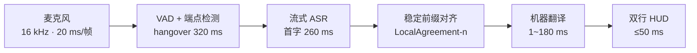

# 镜译 SubLens

**智能眼镜上的端侧实时字幕翻译引擎** —— 说完到上屏 **p95 497 ms**,字幕只前进、不回退。

[](https://github.com/1304857605-create/sublens-realtime-translation/actions/workflows/ci.yml)
[](LICENSE)
[](#)
[](tests/)
[](#)
[](#)


> **English** — SubLens is a real-time subtitle translation engine for smart glasses, written in
> **C++20 with zero third-party dependencies**. It targets a **p95 glass-to-eye latency of ~500 ms**
> by splitting the pipeline into five explicitly budgeted stages, and it keeps subtitles
> **append-only** by committing only the *stable prefix* of streaming ASR hypotheses.
> It runs on Windows/Linux today and ships Android (AAudio + JNI) adapters.
> ASR/MT are pluggable backends; a reproducible simulated pipeline is included so the project
> runs **without any cloud account or GPU**.

---

## 它解决什么问题

把语音变成字幕不难, 难的是两件事:

| 问题 | 常见后果 | 本项目的做法 |
|---|---|---|
| **延迟** | 说完要等 1~3 秒才看到字幕 | 五段预算逐段压: 端点 320 + 首字 260 + 对齐 ≈0 + 翻译 1~180 + 上屏 ≤50 ≈ **700 ms** |
| **字幕闪变** | 流式识别一直在改字, 字幕反复回退 | **稳定前缀对齐**: 只提交"连续 N 次一致"的前缀; 句末做一次整行校正 |

结果: 已上屏的字幕**只增不改**, 用户看到的是"边说边冒出来 → 说完瞬间变完整"。

---

## 核心指标(本机实测, 可复现)

| 指标 | 数值 | 口径 |
|---|---|---|
| 端到端延迟 | **p50 404 ms / p95 497 ms** | 说话人闭嘴 → 译文首次上屏; 实时节奏; 本地 MT |
| 云端 MT 对照 | p95 778 ms(**超标**) | 注入 180±80 ms → 结论: MT 应放端侧 |
| 首字延迟 | p50 279 ms | 语音结束 → 首个 ASR partial |
| VAD 单帧 | mean **249 ns** | 20 ms 音频/帧; 1 分钟音频共 1.37 ms CPU |
| 引擎吞吐 | **54.9× 实时** | 单核占用约 1.8% |
| 无锁音频通道 | 1.9 ns/次; **64 Msamples/s** | 双线程压满; 实时需求 0.016 Msamples/s |

> ⚠️ 单次运行 p95 在 480~550 ms 之间波动; ASR 首字延迟为参数化模拟值(260 ms)。
> 接真实云服务后现实预期 700~900 ms。完整数据与口径见 [docs/BENCHMARK.md](docs/BENCHMARK.md)。

---

## 架构



- **4 条线程**: 采集 / VAD / HUD(+ ASR、MT 后端内部线程), 热路径无锁;
- **依赖注入**: `IAudioSource` / `AsrBackend` / `MtBackend` / `HudRenderer` 四个接口,
  换云端模型、换麦克风、换显示都只改一个类;
- **同一份核心代码**跑桌面与 Android(NDK 适配层在 [`android/`](android/))。

设计取舍与线程模型详见 **[docs/ARCHITECTURE.md](docs/ARCHITECTURE.md)**。

---

## 快速开始

依赖只有 **C++20 编译器 + CMake ≥ 3.20**(免网络、免云账号、无 GPU)。

### Windows

```bat
build.cmd        :: 编译（产出 build\sublens_demo.exe / sublens_tests.exe / sublens_bench.exe）
test.cmd         :: 67 个单元测试
demo.cmd en2zh   :: 实时 HUD 演示（约 24 秒，可录屏）
bench.cmd        :: 6 组基准，输出 Markdown
```

> 自带 `.cmd` 启动器是为了绕开 Windows PowerShell 默认禁止运行 `.ps1` 的限制。

### Linux / macOS

```bash
cmake -B build -G Ninja -DCMAKE_BUILD_TYPE=Release
cmake --build build
./build/sublens_tests          # 67 passed
./build/sublens_demo en2zh     # real-time HUD demo
./build/sublens_bench          # benchmarks
```

演示画面(终端原地刷新; 真实运行时逐帧变化):

```text
.------------------------------------------------------------------.
| SubLens HUD  EN -> ZH  -  listening                    #5  758ms |
|------------------------------------------------------------------|
|  今天天气很适合散步。              <- 主行: 已定稿, 只增不改         |
|  ... 感谢                        <- 草稿行: 未确认的推测, 可整行替换  |
|                                                                  |
|  延迟 758ms   FPS 20.0   已定稿 5 句                              |
'------------------------------------------------------------------'
```

---

## 目录结构

```text
include/sublens/     接口契约(每个头文件开头都有中文设计说明)
src/
  audio/             合成音源 / 静音源 / WAV 文件源
  vad/               自适应能量 VAD + 端点检测
  asr/               流式 ASR 抽象 + 脚本化模拟器 + 云端骨架
  mt/                翻译抽象 + 离线短语表 + 时延注入器
  sched/             ★ 稳定前缀对齐 + 推测式调度(核心算法)
  hud/               HUD 状态机 + 终端 ANSI 渲染
  app/               ★ 4 线程流水线 + 演示程序
  common/            时钟 / 日志 / 延迟直方图 / 对话脚本
bench/               6 组基准(队列 / VAD / 对齐 / HUD / 端到端 / 吞吐)
tests/               67 个单元测试(自带 100 行测试框架)
android/             NDK 构建 + AAudio 采集 + JNI 桥
docs/                架构 / 延迟预算 / 基准 / 云接入 / 代码导读 / 带读计划
tools/               文档配图生成脚本
```

---

## 实测数据怎么来的

每个模块都有对应基准, 一条命令复现:

| 基准 | 测什么 | 命令 |
|---|---|---|
| `ring` | 无锁队列吞吐与延迟分布 | `bench.cmd ring` |
| `vad` | 单帧 CPU 成本 + 端点精度 | `bench.cmd vad` |
| `stabilizer` | LocalAgreement-n 的取舍与 CPU 成本 | `bench.cmd stabilizer` |
| `hud` | 状态机与渲染成本 | `bench.cmd hud` |
| `latency` | 端到端延迟(A/B/C 三组配置) | `bench.cmd latency` |
| `throughput` | 引擎自身实时倍率 | `bench.cmd throughput` |

数字与测量方法全部写在 [docs/BENCHMARK.md](docs/BENCHMARK.md), **不造数、不回避边界**。

---

## 文档

| 文档 | 内容 |
|---|---|
| [docs/START-HERE.md](docs/START-HERE.md) | 第一次看代码: 怎么跑、代码在哪、改一处怎么改 |
| [docs/ARCHITECTURE.md](docs/ARCHITECTURE.md) | 线程模型、模块划分、5 个关键设计决策与取舍 |
| [docs/LATENCY-BUDGET.md](docs/LATENCY-BUDGET.md) | 700 ms 怎么拆出来的、每段怎么测 |
| [docs/BENCHMARK.md](docs/BENCHMARK.md) | 全部实测数据与复现方法 |
| [docs/CLOUD-INTEGRATION.md](docs/CLOUD-INTEGRATION.md) | 接真实云端 ASR/MT 的协议要点与成本估算 |
| [docs/CODE-TOUR.md](docs/CODE-TOUR.md) | 代码导读: 6 个必读片段、3 个改造练习 |
| [docs/HOW-TO-BUILD-IT.md](docs/HOW-TO-BUILD-IT.md) | 从零实现这个项目的 10 步顺序 |
| [docs/GUIDED.md](docs/GUIDED.md) | 8 讲带读 + 掌握度自检 |
| [docs/PRODUCT-READINESS.md](docs/PRODUCT-READINESS.md) | 距离"真产品"还差什么(自我审计) |
| [android/README.md](android/README.md) | NDK 构建、AAudio 采集、厂商适配要点 |

---

## 项目状态与边界(诚实说明)

**引擎是真的, 模型是占位的, 接口已经留好。**

- ✅ 已交付: C++20 引擎、4 线程流水线、67 个单测、6 组基准、桌面实时演示、Android 适配层;
- ⏳ ASR / MT 目前是**可复现的模拟链路**(脚本化 ASR + 离线短语表); 换真云服务只需实现
  `AsrBackend` / `MtBackend`(见 [docs/CLOUD-INTEGRATION.md](docs/CLOUD-INTEGRATION.md));
- ⏳ Android 适配层**已写、未真机验证**; 真机功耗/发热未测;
- ⏳ 未做双人对话的说话人分离(眼镜单麦下最大的工程风险)。

路线图与验收标准见 [docs/PRODUCT-READINESS.md](docs/PRODUCT-READINESS.md)。
这条边界不是免责声明: **它决定了你 clone 下来能玩到什么程度**。

---

## 参与贡献

欢迎 issue 和 PR。开始前请读 [CONTRIBUTING.md](CONTRIBUTING.md)。

适合上手的点(不需要先读懂整个引擎):

- 给 `PhraseTableMt` 补充词表 / 支持新的语言对;
- 实现一个新的 `AsrBackend`(例如某家云厂商的流式协议);
- 在 `HudRenderer` 接口下加一个 OpenGL ES 渲染器;
- 给基准加一组新的对照配置。

提交前请保证:

```bash
cmake -B build -G Ninja -DCMAKE_BUILD_TYPE=Release && cmake --build build
./build/sublens_tests        # 67 passed
```

---

## 许可证

[MIT](LICENSE) © 2026 mirror flower
